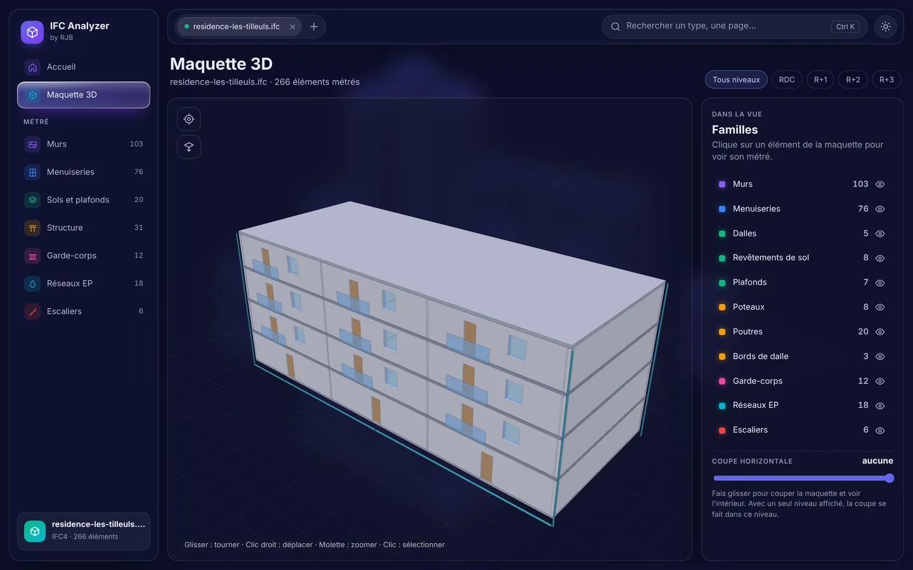
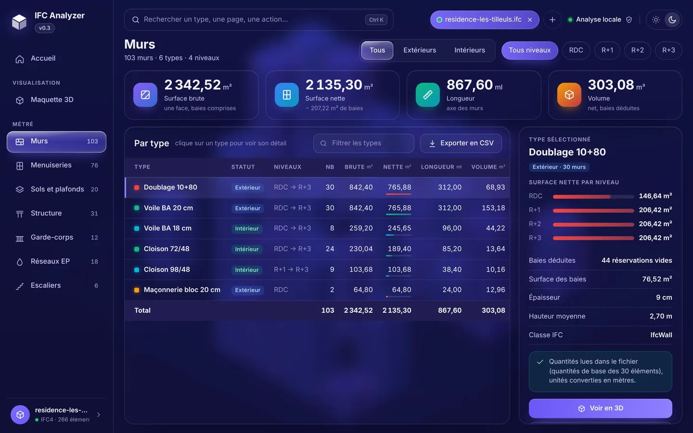

# IFC Analyzer by RJB

<br clear="left" />

Métré et **maquette 3D** d'un fichier IFC, **100 % dans le navigateur** : murs, menuiseries, sols et plafonds, structure,
garde-corps, réseaux EP et escaliers. Aucun serveur, aucune installation, et **le fichier IFC ne quitte jamais le PC**.





## Ce que fait l'appli

- **Ouvre un IFC2x3 ou IFC4** (export Revit, ArchiCAD…) par glisser-déposer ou avec le bouton. Plusieurs fichiers peuvent être ouverts en onglets.
- **Maquette 3D** reliée au métré : un clic sur un élément donne le métré de son type ; « Voir en 3D » depuis
  un tableau allume tous les éléments du type. Filtres par niveau et par famille, coupe horizontale, vue de dessus.
- **Métré par famille et par type** : nombre, surfaces brute et nette, longueurs, volumes, détail par niveau.
- **Filtres** par niveau, par statut (extérieur / intérieur) et par texte ; tri des colonnes.
- **Export CSV** lisible par Excel en français, et copie d'une ligne pour la coller dans Excel.
- **Recherche rapide** `Ctrl K` (un type, une page, une action) ; `Ctrl O` pour ouvrir un fichier.
- **Analyses récentes** gardées dans le navigateur (quantités et 3D calculée, jamais le fichier IFC).
- **Même interface que Transcripteur IA** : barre latérale, onglets, barre du haut, boutons et cartes aux mêmes dimensions.
- Thèmes sombre et clair, appli installable, utilisable hors connexion.

## Règles de métré

| Famille | Quantités | Source, par ordre de priorité |
|---|---|---|
| Murs | surface brute (1 face), surface nette, longueur, volume | quantités de base du fichier (`GrossSideArea`, `NetSideArea`…), puis propriétés de l'export, puis calcul |
| Murs : surface nette | brute − baies | `NetSideArea` du fichier ; sinon surface des **réservations réellement reliées au mur** (pas de prorata) |
| Menuiseries | nombre, largeur, hauteur, surface | `Width`, `Height`, `Area` ; sinon `OverallWidth × OverallHeight` |
| % de façade vitrée | menuiseries ext. / murs ext. bruts | les doublages marqués « extérieurs » sont exclus (sinon la façade compte deux fois) |
| Dalles, revêtements, plafonds | surface, périmètre, volume | `NetArea`, puis `GrossArea` |
| Poteaux, poutres, bords de dalle, garde-corps, réseaux EP | nombre, longueur, volume | `Length`, `NetVolume`, puis `GrossVolume` |
| Escaliers | volées, contremarches, marches | attributs `NumberOfRisers`, `NumberOfTreads` |

- Les **unités du fichier** sont lues (`IfcUnitAssignment`) et tout est converti en m, m², m³ ; une maquette en millimètres est donc correcte.
- Chaque élément n'est compté **qu'une fois** (les sous-types comme `IfcWallStandardCase` ne sont pas relus).
- Un élément **sans quantités** est signalé dans l'appli, avec la marche à suivre dans Revit : cocher « Exporter les quantités de base » à l'export IFC.

## Lancer

Le site doit être servi en HTTP(S) (pas en `file://`, à cause du moteur de lecture IFC et du service worker).

- **En ligne** : GitHub Pages. *Settings → Pages → Build and deployment* : Source « Deploy from a branch », branche `main`, dossier `/ (root)`.
  L'appli est ensuite sur `https://rafjtb.github.io/IFC-Analyzer/`.
- **En local** : `npm run serve` (ou `python3 -m http.server 8094`), puis http://localhost:8094

## Architecture

Pas de compilation : HTML, CSS et modules JavaScript, servis tels quels.

```
index.html             Interface (barre latérale, barre du haut, zone de contenu)
styles.css             Design system RJB : verre dépoli, indigo, thèmes sombre et clair
sw.js                  Service worker : hors connexion, fichiers revérifiés, en-têtes de sécurité
js/app.js              Point d'entrée : état, navigation, ouverture des fichiers, actions
js/ifc/worker.js       Analyse dans un Web Worker : le métré d'abord, puis la géométrie 3D (l'interface reste fluide)
js/ifc/extract.js      Lecture IFC → éléments (unités, niveaux, Psets, quantités, réservations) — fonctions pures
js/ifc/geometrie.js    Géométrie 3D → tampons fusionnés, un bloc par élément, en mètres — fonction pure
js/ifc/noms.js         Noms de types (« Famille:Type:Id » de Revit) et classement par famille — fonctions pures
js/metre/quantites.js  Règles de métré et regroupement par type — fonctions pures
js/metre/familles.js   Pages, familles, colonnes et tuiles
js/metre/export.js     Export CSV
js/ui/vue3d.js         Visionneuse 3D (three.js) : un seul maillage, sélection, niveaux, familles, coupe, clic
js/ui/*.js             Accueil, page de métré, page 3D, recherche Ctrl K, effets (lueur, verre liquide), stockage local
vendor/web-ifc/        Moteur de lecture IFC (web-ifc 0.0.78, licence MPL-2.0), servi par le site lui-même
vendor/three/          Moteur 3D (three.js 0.187.0, licence MIT), chargé seulement à l'ouverture de la page 3D
assets/exemple/        IFC d'exemple (« Résidence Les Tilleuls », fictive)
tools/                 Générateur de l'IFC d'exemple (Python, ifcopenshell) et copie de web-ifc
legacy/                Ancienne version Python / Tkinter, pour référence
```

## Tests

```bash
npm ci
npm test            # tests unitaires puis tests dans le navigateur
```

- **Unitaires** (`node:test`) : l'appli doit retrouver exactement les nombres et quantités de l'IFC d'exemple,
  en IFC4 et en IFC2x3. Ces valeurs (`tests/fixtures/attendu.json`) sont calculées par le générateur, indépendamment de l'appli.
  La géométrie 3D est vérifiée aussi : un bloc par élément, dimensions en mètres, murs percés par leurs réservations.
- **Navigateur** (Playwright) : parcours complet, filtres, export, recherche, rechargement, téléphone, maquette 3D
  (affichage, clic, aller-retour avec le métré, coupe), et **0 violation d'accessibilité** (axe-core) en thème clair et en thème sombre.

Régénérer l'IFC d'exemple, géométrie 3D comprise (le résultat est identique à chaque fois) : `pip install ifcopenshell` puis `npm run exemple`.

## Suite prévue

1. **Estimation** : DPGF par lots, prix unitaires, HT / TVA / TTC, export Excel.
2. **Versions** : comparaison de deux exports d'une même maquette (mise en évidence en 3D), et personnalisation (fonds, couleurs).
